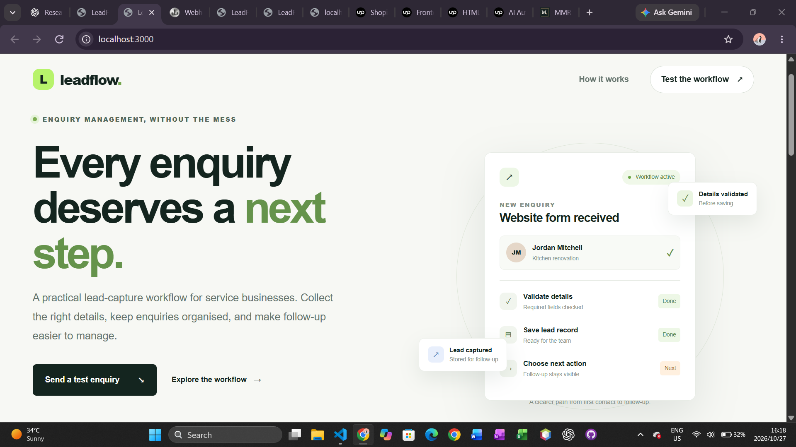
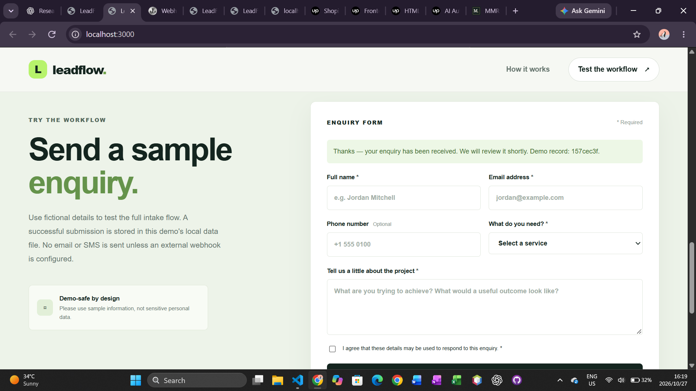
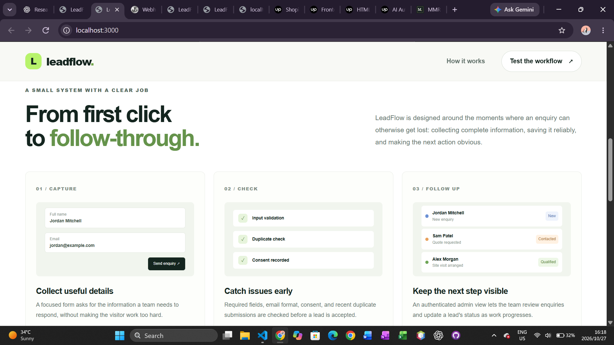
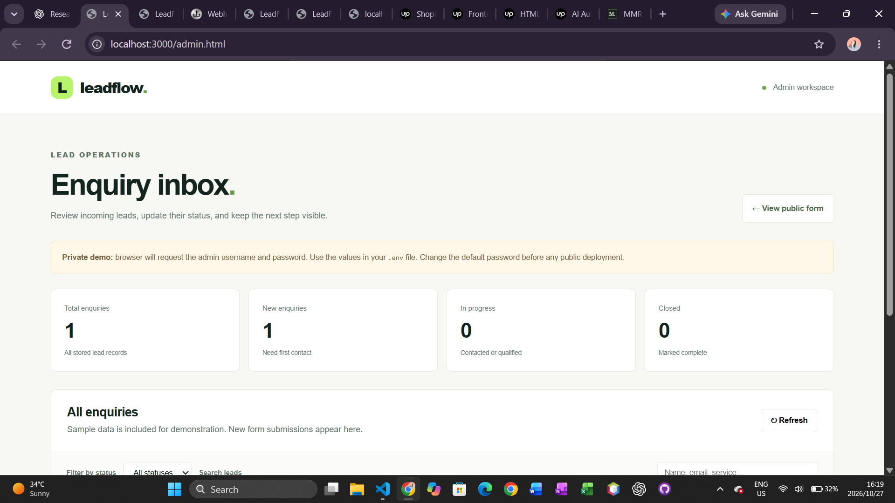
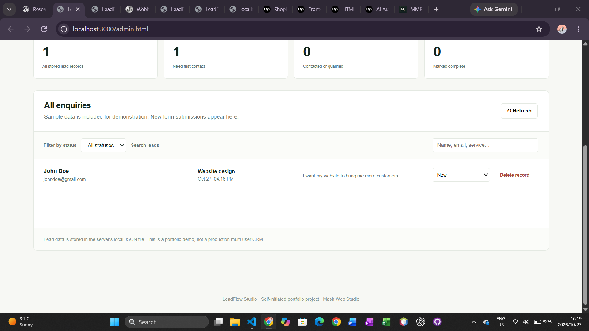

# LeadFlow Studio

**A lead intake and follow-up workflow demonstration for service businesses.**

LeadFlow Studio is a self-initiated portfolio project by Mash Web Studio. It demonstrates how a service business could capture enquiries, validate submissions, maintain lead records, manage follow-up status, and send lead-created events to an external system.

This is a portfolio demonstration, not a commissioned client project. All test submissions use fictional information.

## Project Overview

Small service businesses can receive enquiries through their websites but still struggle to collect complete information, prevent duplicate submissions, keep records organised, and follow up consistently.

LeadFlow Studio demonstrates a lightweight workflow for addressing those problems.

### Key Features

- Responsive public enquiry form.
- Client-side and server-side input validation.
- Express REST API with bounded request size.
- JSON-file persistence for local, low-volume demonstrations.
- Duplicate-email prevention within a 24-hour window.
- Honeypot field and in-memory rate limiting for basic bot and request-noise resistance.
- Private admin dashboard protected by HTTP Basic Authentication.
- Lead listing, searching, filtering, status updates, and deletion.
- Optional persistent webhook outbox with asynchronous delivery.
- Retry handling for transient webhook failures.
- Dead-letter retention for non-retryable responses and exhausted attempts.
- Automated tests using Node.js's built-in test runner.

## Technology Stack

| Technology | Purpose |
|---|---|
| Node.js | Server runtime |
| Express | HTTP server and REST API |
| HTML | Page structure |
| CSS | Responsive presentation |
| Vanilla JavaScript | Client-side interactions |
| JSON files | Local lead and webhook-queue persistence |
| Node.js test runner | Automated tests |

The local demonstration does not require a separate database server or a paid integration service.

## Architecture

```text
                    Visitor
                       |
                       v
              Public enquiry form
                       |
                       | POST /api/leads
                       v
                 Express API
                       |
              Validation and checks
                       |
              +--------+---------+
              |                  |
              v                  v
        Lead JSON store    Persistent webhook
              |             outbox (optional)
              |                  |
              v                  v
        Admin REST API      Background worker
              |                  |
              v                  v
       Admin dashboard     External webhook
                              endpoint
```

When webhook integration is configured, accepted lead submissions generate a `lead.created` event. The event is written to the local outbox and delivered asynchronously.

The outbox is file-backed and intended for a single application process. It is not a distributed queue.

## Screenshots

The repository includes screenshots of the public interface and administration workflow.

### Public homepage



### Enquiry form



### Workflow explanation



### Admin dashboard



### Lead management



## Run Locally

### Requirements

- Node.js 18.17 or newer.
- npm.
- A terminal such as the VS Code integrated PowerShell terminal.

### 1. Install dependencies

Open the project directory in VS Code and run:

```powershell
npm.cmd ci
```

This installs the dependencies specified by the lockfile.

### 2. Configure environment variables

The application reads configuration directly from `process.env`. It does not automatically load a `.env` file.

For a Windows PowerShell development session, configure the variables before starting the application:

```powershell
$env:PORT = "3000"
$env:NODE_ENV = "development"
$env:ADMIN_USER = "demo"
$env:ADMIN_PASSWORD = "replace-this-with-a-long-unique-password"
$env:DATA_FILE = "./data/leads.json"
$env:WEBHOOK_QUEUE_FILE = "./data/webhook-outbox.json"
```

Choose a unique admin password. These environment variables apply to processes launched from the current PowerShell session.

### 3. Start the application

```powershell
npm.cmd start
```

Open the public application at:

`http://localhost:3000`

The server creates the lead-data file when necessary.

### 4. Open the admin dashboard

Navigate to:

`http://localhost:3000/admin.html`

Enter the configured admin username and password when prompted.

### 5. Run the automated tests

In a separate terminal, run:

```powershell
npm.cmd test
```

The tests use temporary data and a local HTTP server where applicable.

## Testing and Verification

### Automated tests

**Verified result: 11 tests passed, 0 failed.**

The test run covered:

- Health endpoint.
- Invalid submission handling.
- Lead storage and admin authentication.
- Duplicate-email prevention.
- Authenticated status updates and deletion.
- Rejection of invalid status values.
- Persistent webhook enqueue and successful delivery.
- Retry after a transient HTTP 503 response.
- Dead-letter retention for an HTTP 400 response.
- Recovery of queued work by a new outbox instance.
- Behaviour when no webhook endpoint is configured.

The full test suite was run locally after installing dependencies.

### Manual webhook integration test

A fictional lead was submitted through the running application, and Webhook.site received an HTTP POST request containing the `lead.created` event.

The received JSON payload included the expected fictional lead details. The request also displayed the `X-LeadFlow-Event-Id` header.

Afterward, the local outbox file was inspected and contained an empty array:

```json
[]
```

Together, the received event and empty queue provide evidence of successful delivery for this test.

This manual test verified successful delivery; it did not independently validate every retry, failure, or recovery scenario against a live endpoint.

## Optional Webhook Integration

LeadFlow can send events to an external webhook endpoint when `LEAD_WEBHOOK_URL` is configured.

Set the environment variable before starting the server:

```powershell
$env:LEAD_WEBHOOK_URL = "https://your-webhook-endpoint.example"
npm.cmd start
```

Replace the example with an HTTPS endpoint you control.

When a lead is accepted, the application attempts to write a `lead.created` event to the persistent outbox. If the write succeeds, the API reports the workflow as queued. A background worker attempts delivery.

### Example payload

```json
{
  "event": "lead.created",
  "lead": {
    "id": "example-uuid",
    "name": "Sample Visitor",
    "email": "sample@example.com",
    "service": "Website design",
    "status": "new"
  }
}
```

The actual payload includes additional lead fields and timestamps.

### Delivery behaviour

The worker retries network errors, timeouts, HTTP 408, HTTP 429, and HTTP 5xx responses using exponential backoff and jitter.

Other non-successful HTTP responses are retained as dead-letter records rather than retried automatically. Events that exhaust the configured attempt limit are also retained for inspection.

Outgoing requests include:

- `Idempotency-Key`
- `X-LeadFlow-Event-Id`

Both headers identify the event. The receiving system must implement its own idempotency handling if it needs to prevent duplicate processing.

The outbox is stored at `./data/webhook-outbox.json` by default. Its location can be changed using `WEBHOOK_QUEUE_FILE`.

**Security:** The outbox contains full event payloads, including personal information submitted through the form. Protect the file and never use real customer data in public demonstrations.

## API Reference

| Method | Endpoint | Authentication | Purpose |
|---|---|---|---|
| GET | `/api/health` | None | Health check |
| POST | `/api/leads` | None | Validate and create a lead |
| GET | `/api/leads` | Basic Auth | List leads |
| PATCH | `/api/leads/:id/status` | Basic Auth | Update a lead's status |
| DELETE | `/api/leads/:id` | Basic Auth | Delete a lead |

Supported lead statuses:

- `new`
- `contacted`
- `qualified`
- `closed`

## Security and Limitations

LeadFlow Studio is a portfolio demonstration, not a production-ready CRM.

Important limitations include:

- Lead data is stored in JSON files rather than a transactional database.
- The file-backed webhook outbox is intended for a single application process.
- There is no built-in admin interface for managing dead-letter events.
- Outgoing webhook requests do not include cryptographic request signatures.
- Basic Authentication is not a complete production identity and access-management solution.
- Rate limiting is held in memory and resets when the server restarts.
- The local filesystem must be durable if lead records and queued events need to survive restarts.
- The application does not send real email or SMS notifications and does not connect to a CRM by default.
- Delivery and queue behaviour should be tested under the conditions expected in a real deployment.

For a production implementation, consider a transactional database, a managed queue or database-backed job system, secure secret management, webhook signatures, monitoring, alerting, backup procedures, and stronger authentication.

## Future Improvements

Potential future improvements include:

- A database-backed persistence layer.
- Integration with a CRM or workflow automation platform.
- Webhook delivery monitoring and dead-letter management.
- Automated end-to-end integration tests.
- Improved deployment configuration and operational logging.
- Stronger authentication and access control.

These are potential enhancements, not claims about features currently implemented.

## Project Status

LeadFlow Studio demonstrates a working lead intake and management API, local persistence, protected administration, and optional webhook delivery.

The automated test suite passed 11 tests, and a manual test confirmed successful delivery of a fictional lead-created event to an external webhook endpoint.

The project remains a learning and portfolio demonstration. Production deployment would require additional security, reliability, and operational work.

## About

**Built by Mash Web Studio** as a self-initiated portfolio project exploring web development, backend APIs, and workflow integration.

The project demonstrates practical implementation and testing rather than claiming an existing client deployment.